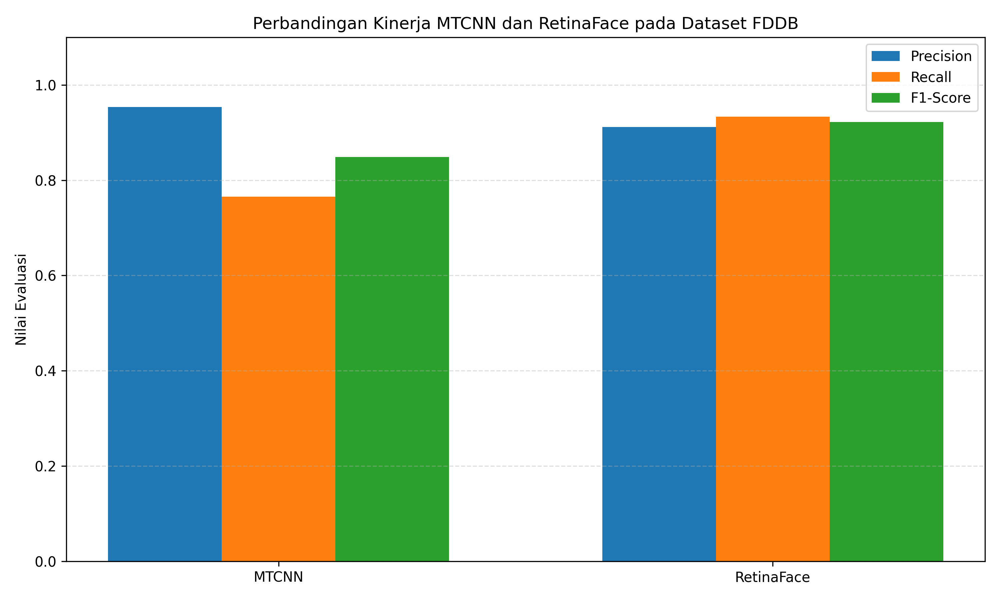
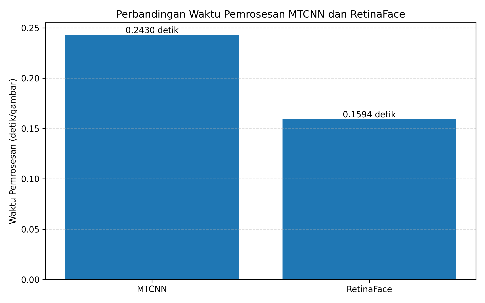

# ANALISIS PERBANDINGAN MTCNN DAN RETINAFACE

**Analisis Perbandingan Kinerja Algoritma MTCNN dan RetinaFace dalam Deteksi Wajah Menggunakan Dataset FDDB**

## Deskripsi Proyek

Penelitian ini bertujuan membandingkan kinerja algoritma MTCNN dan RetinaFace dalam mendeteksi wajah menggunakan dataset Face Detection Data Set and Benchmark (FDDB).

Pengujian dilakukan dengan mengukur Precision, Recall, F1-Score, serta waktu deteksi rata-rata per gambar.

## Dataset

- Nama: FDDB (Face Detection Data Set and Benchmark)
- Jumlah gambar: 2.845
- Jumlah anotasi wajah: 5.171

## Hasil Pengujian

| Metrik | MTCNN | RetinaFace |
|---|---:|---:|
| True Positive | 3.957 | 4.828 |
| False Positive | 192 | 469 |
| False Negative | 1.214 | 343 |
| Precision | 95,37% | 91,15% |
| Recall | 76,52% | 93,37% |
| F1-Score | 84,91% | 92,24% |
| Waktu/gambar | 0,2430 detik | 0,1594 detik |

## Visualisasi Hasil

### Perbandingan Precision, Recall, dan F1-Score

### Perbandingan Waktu Deteksi

## Kesimpulan

Berdasarkan hasil pengujian, MTCNN memiliki nilai Precision lebih tinggi, sedangkan RetinaFace memiliki nilai Recall dan F1-Score lebih tinggi.

RetinaFace mendeteksi lebih banyak wajah yang sesuai dengan anotasi dataset, sementara MTCNN menghasilkan lebih sedikit False Positive.

Hasil ini menunjukkan bahwa RetinaFace memberikan keseimbangan Precision dan Recall yang lebih baik pada pengujian ini.

## Struktur Repository

- `CCTV_FACE_DETECTIONS (2).ipynb` — Notebook eksperimen Google Colab.
- `hasil_evaluasi_fddb.csv` — Hasil evaluasi deteksi.
- `tabel_hasil_akhir_fddb.csv` — Rekapitulasi hasil akhir.
- `grafik_evaluasi_fddb.png` — Grafik metrik evaluasi.
- `grafik_waktu_fddb.png` — Grafik waktu deteksi.

## Catatan Metodologi

Evaluasi menggunakan konversi anotasi elips FDDB menjadi bounding box, pencocokan Hungarian, dan ambang IoU 0,5. Hasil ini merupakan evaluasi berdasarkan pendekatan tersebut, bukan skor resmi benchmark FDDB.

Waktu pengujian perlu ditafsirkan dengan mempertimbangkan konfigurasi perangkat: RetinaFace dijalankan menggunakan GPU, sedangkan MTCNN menggunakan CPU.
